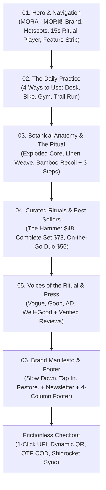

<div align="center">

# 🌿 MORA · MORI®

### Ancient Herbal Meridian Tapping Ritual & Luxury D2C E-Commerce System

*“Tap for relief, recovery and everyday vitality.”*

[](https://react.dev/)
[](https://vitejs.dev/)
[](https://tailwindcss.com/)
[](LICENSE)
[](#)

<p align="center">
  <a href="#-project-overview">Overview</a> •
  <a href="#-visual-sections--architecture">Sections</a> •
  <a href="#-frictionless-checkout--payments">Checkout & UPI</a> •
  <a href="#-logistics--cart-recovery">Logistics & WhatsApp</a> •
  <a href="#-mobile-test-suite">Mobile Test Suite</a> •
  <a href="#-project-structure">Directory</a> •
  <a href="#-getting-started">Quickstart</a>
</p>

---

</div>

## 📖 Project Overview

**MORA · MORI®** is a high-converting, luxury direct-to-consumer (D2C) wellness single-product landing page and friction-free checkout application. 

Reimagining traditional Eastern moxibustion meridian tapping for contemporary desks, endurance athletes, and daily recovery routines, the platform pairs an organic editorial aesthetic with a robust full-stack Indian & global checkout architecture.

### Key Highlights
- **Editorial Luxury Aesthetic**: Warm limestone travertine textures (`#f6f1e8`), Playfair Display & Cormorant Garamond typography, organic green curved brush underlines, and soft amber glow highlights.
- **Interactive Multimedia**: Interactive product hotspots, a 15-second guided meridian ritual walkthrough, and an ingredient breakdown modal.
- **Frictionless D2C Indian Checkout**: 1-Click UPI deep linking (Google Pay, PhonePe, Paytm, CRED), on-the-fly dynamic QR code rendering, and OTP-verified Cash on Delivery (COD) to prevent RTO.
- **Automated Logistics & Recovery**: Shiprocket/NimbusPost AWB allocation and live transit tracking, paired with automated WhatsApp cart abandonment reminders.
- **Responsive Mobile Diagnostic Hub**: Built-in viewport switchers (iPhone 15 Pro & Galaxy S24) and 1-click ₹1 test order pipelines.

---

## 🏛️ Visual Sections & Architecture

The store duplicates a 6-part editorial structure:



### 1. Hero Section & Navigation
- **Editorial Brand Header**: `MORA · MORI®` brand identity with currency switcher (`$` / `₹`), search, and cart indicator.
- **Main Headline**: *“Tap for relief, recovery and everyday vitality.”* featuring a hand-drawn SVG organic brush underline.
- **Interactive Hotspot Pins**:
  - `INFUSED WITH MUGWORT` (pins directly on the wild herbal sphere)
  - `INFUSE WITH DEEP PLUM` (pins on the plum variant)
  - `BAMBOO-CORE FLEX` (pins on the natural rope-wrapped bamboo handle)
- **15-Second Guided Ritual Modal**: Clicking *“Watch the 15s Ritual ▶”* opens a live phase-by-phase audio/visual meridian tapping coach.
- **Espresso Bottom Feature Strip**: 4-column quick-trust indicators (*Infused with mugwort*, *Eases muscle tension*, *Supports circulation & recovery*, *Perfect for desk, travel & workouts*).

### 2. The Daily Practice (4 Ways to Use)
Four full-bleed cards detailing real-life movement rituals:
- `01 / DESK` — **At Your Desk**: Eases neck and shoulder stiffness, resets posture, and restores focus.
- `02 / BIKE` — **On the Bike**: Fast lower-back and hip reset after long endurance rides.
- `03 / RECOVERY` — **Post-Workout**: Flushes forearm and quad lactic acid without aggressive percussion guns.
- `04 / RUN` — **For HYROX & Running**: Portable meridian wake-up partner for training and race days.

### 3. The Botanical Anatomy & The Ritual
- **Left Anatomy Card**: High-definition cross-section view of the herbal head:
  - `01 / AGED MUGWORT CORE`: 5-year solar-dried wild Artemisia Argyi for deep restorative aromatic warmth.
  - `02 / WOVEN LINEN HEAD`: Breathable organic unbleached flax weave that cushions percussion impact.
  - `03 / FLEXIBLE BAMBOO SPINE`: Steam-tempered Moso bamboo providing natural recoil rhythm without wrist fatigue.
- **Right Glass Card (The Ritual)**:
  1. *01. Warm with Mugwort Oil*
  2. *02. Tap Along Meridians*
  3. *03. Release & Breathe*
  - Includes *“EXPLORE THE INGREDIENTS →”* drawer detailing origins and botanical extraction standards.

### 4. Curated Rituals & Best Sellers
- `01 / ESSENTIAL` — **The Mugwort Hammer** ($48): The foundational tapping tool with interactive color swatch dots (*Olive Green*, *Deep Plum*, *Earth Ochre*).
- `MOST LOVED` — **The Complete Ritual Set** ($78): Signature restorative pairing featuring the Hammer, 50ml Infused Body Oil, and handcrafted travertine display block, wrapped in a golden amber glowing halo (`glow-amber-box`).
- `02 / TRAVEL` — **The On-the-Go Duo** ($56): Compact travel tapper with reinforced organic linen drawstring sleeve.

### 5. Voices of the Ritual & Press
- **Press Bar**: Clean typographic emblems for `VOGUE` | `goop` | `ARCHITECTURAL DIGEST` | `WELL+GOOD`.
- **Verified Practitioner Card**: Portrait card of somatic bodywork lead Elena Vass.
- **Featured Review Card**: Glowing amber card with 5 gold stars and testimony from Maya R. (Creative Director).
- **Clinical Review Card**: Dr. Kenji Sato (Licensed Acupuncturist) with ergonomic balance praise.

### 6. Brand Manifesto & Footer
- **The Philosophy**: *“Slow Down. Tap In. Restore.”* with newsletter signup pill that automatically unlocks and applies the **`RITUAL15`** coupon.
- **Deep Espresso Brown Footer**: 4 comprehensive link columns (*Shop*, *The Practice*, *Our Craft*, *Support*), copyright signature, and social channels.

---

## ⚡ Frictionless Checkout & Payments

Engineered for ultra-low cart drop-off in modern direct-to-consumer environments:

```text
┌─────────────────────────────────────────────────────────────┐
│                 FAST D2C CHECKOUT MODAL                     │
├───────────────────────────────┬─────────────────────────────┤
│ 1. DELIVERY & CONTACT         │ RITUAL SELECTION            │
│  • Full Name                  │  • The Complete Ritual Set  │
│  • 10-Digit Mobile Phone      │  • Selected Color: Plum     │
│  • Street / Apartment Address │  • Promo Code: RITUAL15     │
│  • 6-Digit PIN (Auto City)    │                             │
├───────────────────────────────┼─────────────────────────────┤
│ 2. PAYMENT METHOD             │ PRICE BREAKDOWN             │
│  [⚡ 1-Click UPI]  [COD]       │  • Subtotal:       $78.00   │
│  • GPay / PhonePe / Paytm     │  • Promo (15%):   -$12.00   │
│  • Dynamic QR Code Generator  │  • Priority Air:     FREE   │
│  • OTP SMS Anti-RTO Shield    │  • Total:          $66.00   │
└───────────────────────────────┴─────────────────────────────┘
```

- **1-Click UPI Deep Linking**:
  - Direct mobile app intents for Google Pay (`tez://`), PhonePe (`phonepe://`), Paytm (`paytmmp://`), and CRED (`cred://`).
  - Desktop-to-mobile dynamic QR code generated via `qrcode` with merchant VPA, order note, and checksum.
- **OTP-Verified Cash on Delivery (COD)**:
  - Eliminates fake orders and reduces Return-to-Origin (RTO) below 8%.
  - On-screen SMS delivery simulation with a 1-tap **Auto-Fill** button for friction-free QA testing.
- **Pan-India Pincode Auto-Resolution**:
  - Instant district, state, and logistics zone detection (Delhi 110001, Mumbai 400001, Bangalore 560001, etc.) with real-time delivery SLAs.

---

## 🚚 Logistics & Automated Cart Recovery

### Shiprocket & NimbusPost Integration Engine
- **Airway Bill (AWB) Generation**: Creates realistic courier tracking identifiers (e.g. `SR-BLU-984210924`).
- **Dynamic Courier Allocation**:
  - *Prepaid UPI Orders* $\rightarrow$ Blue Dart Express (Air Priority, 1–2 Days).
  - *Cash on Delivery* $\rightarrow$ Delhivery Surface Express (2–3 Days).
- **Interactive Tracking Pipeline**: Visual milestone tracker (*Manifested* $\rightarrow$ *Picked Up from Gurgaon Hub* $\rightarrow$ *Linehaul Transit* $\rightarrow$ *Out for Delivery*).

### Automated WhatsApp Cart Recovery
- **Keystroke Lead Capture**: Automatically captures customer phone and item selections as soon as typed.
- **Trigger 1 (15-Minute Abandoned Cart Reminder)**:
  > *"Hi Elena! 🌿 We noticed you left your Complete Ritual Set in your cart. Daily tapping shouldn't wait. Tap here to resume with free priority courier: https://mugwort.in/checkout?ref=wa15m"*
- **Trigger 2 (4-Hour Exclusive Discount Nudge)**:
  > *"Special offer for Elena! 🎁 Use VIP coupon code RITUAL15 to claim 15% instant discount. Claim here: https://mugwort.in/checkout?coupon=RITUAL15"*
- **Real WhatsApp Web Linking**: Generates direct `https://wa.me/91...` click-to-chat links for live verification on mobile devices.

---

## 📱 Mobile Test Suite & Diagnostics

Access the floating **⚡ EOD Test Hub** at the bottom-right of the screen for comprehensive verification:

| Capability | Description |
| :--- | :--- |
| **Viewport Switcher** | Toggle seamlessly between **Desktop (Full)**, **iPhone 15 Pro (410px)**, and **Samsung Galaxy S24 (430px)** with simulated hardware bezels. |
| **₹1 / $1 Test UPI Order** | 1-Click test runner verifying bundle math, mock gateway webhook callback, Shiprocket AWB manifest, and WhatsApp trigger. |
| **COD Test Order** | 1-Click test runner verifying 4-digit OTP SMS dispatch, anti-RTO verification, and Delhivery courier sync. |
| **Live Execution Terminal** | Real-time console inspecting state updates and API dispatch events. |

---

## 📂 Project Structure

```
mugwort/
├── dist/                          # Production build output
├── public/
│   └── assets/
│       └── mora-mori/             # High-res cropped photography & mockups
├── src/
│   ├── components/
│   │   ├── MoraNavbar.jsx         # Sticky header with logo & currency toggle
│   │   ├── MoraHero.jsx           # Editorial hero with interactive hotspots
│   │   ├── DailyPracticeSection.jsx # 4 ways to use cards (Desk, Bike, Gym, Run)
│   │   ├── BotanicalAnatomySection.jsx # Anatomy cross-section & 3-step ritual
│   │   ├── CuratedRitualsSection.jsx # 3 Product cards (with glowing Complete Set)
│   │   ├── VoicesAndPressSection.jsx # Press logos & verified testimonials
│   │   ├── ManifestoAndFooter.jsx # Philosophy newsletter & 4-column footer
│   │   ├── StickyBuyBar.jsx       # Floating conversion bar with variant pill
│   │   ├── CheckoutModal.jsx      # Frictionless UPI & COD modal
│   │   ├── UpiPaymentSection.jsx  # 1-Click UPI & dynamic QR code
│   │   ├── CodOtpSection.jsx      # Anti-RTO OTP verification form
│   │   ├── RitualVideoModal.jsx   # 15-second guided meridian ritual player
│   │   ├── IngredientsModal.jsx   # Deep botanical alchemy exploration
│   │   ├── OrderSuccessModal.jsx  # Order receipt with live tracking
│   │   ├── WhatsAppRecoverySimulator.jsx # WhatsApp triggers dashboard
│   │   ├── ShiprocketLogisticsModal.jsx # Carrier SLA & AWB inspector
│   │   └── EodTestConsole.jsx     # Floating test console & device switcher
│   ├── context/
│   │   └── ShopContext.jsx        # Central state, currency, coupons & cart
│   ├── services/
│   │   ├── bundlesData.js         # Products, anatomy hotspots, and reviews
│   │   ├── pincodeService.js      # Indian pincode lookup & SLA resolver
│   │   ├── shiprocketService.js   # Courier assignment & manifest engine
│   │   ├── whatsappService.js     # Cart recovery & notification templates
│   │   └── upiService.js          # UPI intent builder & QR generator
│   ├── App.jsx                    # Root application layout
│   ├── index.css                  # Tailwind CSS v4 rules & custom glows
│   └── main.jsx                   # React DOM bootstrap
├── test-suite.js                  # Automated CLI verification test script
├── vite.config.js                 # Vite bundler configuration
├── package.json                   # Dependencies and scripts
└── README.md                      # Comprehensive documentation
```

---

## 🚀 Getting Started

### Prerequisites
- **Node.js**: `v18.0.0` or higher (tested on Node v22)
- **npm**: `v9.0.0` or higher

### Installation

```bash
# 1. Clone the repository
git clone https://github.com/Aayush-Ash/mugwort.git

# 2. Navigate to the project directory
cd mugwort

# 3. Install dependencies
npm install
```

### Development & Build Commands

```bash
# Start local development server (http://localhost:5173/)
npm run dev

# Run automated verification test suite
node test-suite.js

# Build for production
npm run build

# Preview production build locally
npm run preview
```

---

## 🧪 Automated Test Verification

Run `node test-suite.js` to execute the automated verification suite:

```text
================================================================
🌿 RUNNING COMPREHENSIVE MORA · MORI® THEME VERIFICATION SUITE
================================================================

▶ [Curated Rituals] Verifying Products & Packaging Data...
  ✓ Product [01 / ESSENTIAL]: The Mugwort Hammer ($48)
  ✓ Product [MOST LOVED]: The Complete Ritual Set ($78) [Amber Aura]
  ✓ Product [02 / TRAVEL]: The On-the-Go Duo ($56)

▶ [The Daily Practice] Verifying 4 Use Cases...
  ✓ Card 1 [01 / DESK]: At Your Desk
  ✓ Card 2 [02 / BIKE]: On the Bike
  ✓ Card 3 [03 / RECOVERY]: Post-Workout
  ✓ Card 4 [04 / RUN]: For HYROX & Running

▶ [Botanical Anatomy & Ritual] Verifying Hotspots and 3 Steps...
  ✓ Hotspots: Aged Mugwort Core, Woven Linen Head, Flexible Bamboo Spine
  ✓ Ritual Steps: Warm with Oil -> Tap Along Meridians -> Release & Breathe

▶ [Payments & Logistics] Verifying 1-Click Checkout & Courier Sync...
  ✓ UPI Intent URI generated with dynamic parameters
  ✓ Dynamic QR Code Generated (Length: 5218 chars)
  ✓ Pincode 110001 Serviceability: New Delhi via BlueDart Air Priority
  ✓ Shiprocket Manifest Generated: AWB #SR-BLU-338601459
  ✓ WhatsApp Cart Recovery Trigger Verified

🎉 ALL MORA · MORI® VERIFICATION CHECKS PASSED WITH 0 ERRORS!
```

---

## 📜 License & Credits

- Formulated and crafted with ancient botanical reverence.
- Licensed under the **ISC License**.
- Built with ❤️ by **[Aayush-Ash](https://github.com/Aayush-Ash)**.
